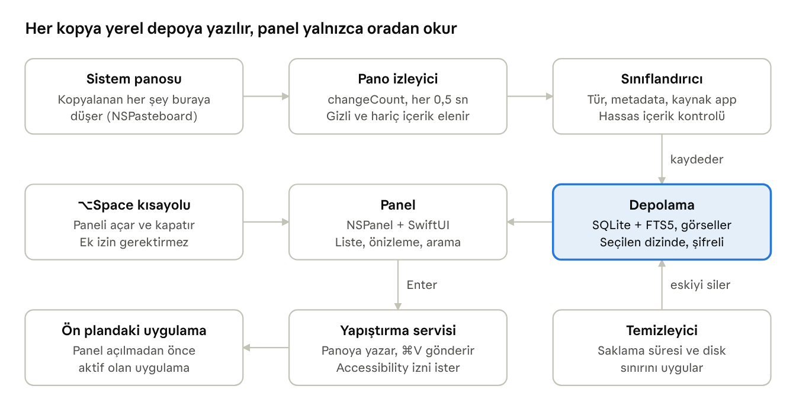

# Clipboard Uygulaması — Aşamalı Plan

25 Kasım 2026 · Kaynak: https://claude.ai/artifact/WqD5R4LV8YUWdcwewLYc9s

## Özet

macOS için native, Raycast tarzı bir pano geçmişi uygulaması yapıyoruz. Uygulama ⌥Space ile (varsayılan; ayarlardan değiştirilebilir) ekranın ortasında açılır, arka planda görünmez çalışır ve kopyalanan her şeyi senin seçtiğin dizinde saklar. İş 5 aşamada ilerler. Her aşama tek başına kullanılabilir bir sürüm üretir.

Temel ilkeler:

- **Görünmez:** Dock'ta ve menü barda ikon yok. İkisi de ayarlardan açılabilir.
- **Klavye öncelikli:** Her işlemin bir kısayolu var. Fare zorunlu değil.
- **Yerel ve kapalı:** Uygulamanın ağ erişimi yok. Hiçbir veri cihazdan çıkmaz.
- **Güvenli varsayılanlar:** Hassas içerik ayrı, şifreli bir Gizli sekmede durur ve Touch ID ile açılır. İstersen hiç kaydedilmez.
- **Hızlı:** Panel 100 ms altında açılır, arama yazarken anında sonuç verir.

Akış: bu planı onaylarsın → alternatifleriyle tasarım önerisi gelir → tasarımı onaylarsın → Aşama 0'dan başlarız.

## Açık kararlar

Aşağıdaki dört kararda önerilen varsayılanı yazdım. Katılmıyorsan "Senin kararın" sütununa yaz, planı ona göre güncellerim.

| # | Karar | Önerilen varsayılan | Neden | Senin kararın |
| --- | --- | --- | --- | --- |
| 1 | Kim kullanacak? | Sadece sen. Dağıtım Aşama 4'e ertelenir. | Developer hesabı mevcut. Notarization ve güncelleme sistemi şimdilik gerekmez. |  |
| 2 | Minimum macOS | macOS 14 Sonoma | SwiftUI'nın güncel API'leri (`@Observable` gibi) kullanılabilir. Sen macOS 15 kullanıyorsun. |  |
| 3 | Depolama dizini | Varsayılan: `~/Library/Application Support/<AppAdı>`. Ayarlardan değiştirilebilir. | Seafile gibi senkronize klasörler açık SQLite dosyasını bozabilir ve hassas veriyi buluta taşır. Senkronize klasör seçilirse uyarı çıkar ve şifreleme zorunlu olur. |  |
| 4 | Enter'ın davranışı | Enter = seçili kaydı kopyala. İlk sürümde otomatik yapıştırma yok. | Accessibility izni gerekmez, ilk sürüm sade kalır. Otomatik yapıştırma Aşama 3'e taşındı. |  |
| 5 | Uygulama adı | Belirlenmedi | Bundle ID ve klasör adı için Aşama 0'da gerekli. |  |

## Teknik mimari

Uygulama tamamen native: Swift + SwiftUI, gerektiği yerde AppKit. Kopyalanan içerik önce yerel depoya yazılır, panel sadece bu depodan okur.

Ayarlar ekranı (⌘,) izleyiciyi, depolamayı, temizleyiciyi ve kısayolu yapılandırır. Çizimi sade tutmak için gösterilmedi.

| Katman | Seçim | Neden |
| --- | --- | --- |
| Dil | Swift 6 | Native, hızlı, düşük kaynak tüketimi |
| Arayüz | SwiftUI + AppKit (`NSPanel`) | Odak çalmayan, yuvarlak köşeli, blur'lu panel AppKit ister |
| Veritabanı | SQLCipher 4.20 (GRDB 7.12, `Vendor/GRDB`) + FTS5 | Tek dosya, hızlı tam metin arama; arama indeksi dahil tüm veritabanı şifreli. GRDB, resmi yöntemle (`Package.swift`) Zetetic'in resmi SQLCipher.swift paketine bağlanır. |
| Global kısayol | Kendi `GlobalHotKey` sınıfımız (Carbon `RegisterEventHotKey`) | Ek izin gerektirmez. KeyboardShortcuts 2.x+ Xcode'a bağlı `#Preview` makrosu kullandığı için çıkarıldı; bir dış bağımlılık da azaldı. Kısayol kayıt arayüzü Aşama 1'de yazılır. |
| Şifreleme | Rastgele 256-bit anahtar Keychain'de (Raycast modeli) + HKDF ile ayrı veritabanı/görsel anahtarları; görseller AES-256-GCM (CryptoKit); kurtarma şifresi PBKDF2-SHA256 600.000 tur (CommonCrypto) | Arka planda şifre sormadan çalışır; kurtarma şifresi geçmişi başka Mac'te açar |
| Otomatik başlatma | `SMAppService` | macOS 13+ için Apple'ın önerdiği yöntem |
| Derleme | SwiftPM + build script, VSCode | Xcode IDE gerekmez, Command Line Tools yeter |

## Tasarım

Seçilen yerleşim: **B — Kenar çubuğu** (kategoriler solda ve sayılarıyla, ortada liste, sağda önizleme ve detay). Ayarlar ekranı aynı canvas'ta.
Tasarım canvas'ı: https://claude.ai/artifact/S9yB8Dx9ParN7v2y7gZ7tW

## Aşama 0 — Proje kurulumu

Bu aşama sonunda boş ama derlenen, imzalanan ve arka planda çalışan bir uygulama olur.

- [x] Swift Package Manager projesi, VSCode + Swift eklentisiyle yazılır (Xcode IDE gerekmez): SwiftUI + AppKit, `LSUIElement = YES` (Dock ve menü bar ikonu yok)
- [x] Mevcut Developer hesabının Developer ID sertifikasıyla imzalama. .app paketi, Info.plist ve entitlements bir build script'iyle (make) üretilir
- [x] Bağımlılıklar: GRDB (SQLite). Global kısayol kendi kodumuzla (Carbon)
- [x] Sandbox açık, ağ erişimi kapalı
- [x] `git init` ve temel klasör yapısı

**Kabul kriteri:** Uygulama açılır, Dock'ta ve menü barda görünmez, Activity Monitor'da çalışır durumda görünür.

## Aşama 1 — MVP

Bu aşama sonunda Raycast clipboard'u günlük kullanımda tamamen değiştirebilen bir uygulama olur.

**Pano takibi**

- [x] `NSPasteboard.changeCount` her 0,5 saniyede kontrol edilir
- [x] Tür tespiti: Text, Link, Image, File, Color
- [x] Aynı içerik tekrar kopyalanınca yeni kayıt açılmaz, mevcut kayıt en üste çıkar ve sayacı artar
- [x] Kaynak uygulama ve (Chromium tarayıcılarda) kaynak URL kaydedilir
- [x] `ConcealedType` / `TransientType` işaretli içerik bu aşamada kaydedilmez (şifre yöneticileri). Aşama 2'de Gizli sekmede saklanabilir
- [x] Hariç tutulan uygulamalar listesi (varsayılan: 1Password, Bitwarden, Keychain Access)

**Panel**

- [x] ⌥Space (varsayılan, ayarlardan değiştirilebilir) ile ekranın ortasında açılır, odak çalmayan `NSPanel`
- [x] Esc veya dışarı tıklama ile kapanır
- [x] Solda liste, sağda önizleme ve detaylar (metadata tablosu)
- [x] Kategori sekmeleri: All, Text, Links, Images, Files
- [x] Arama (SQLite FTS5), yazarken anında filtreler
- [x] Enter ile kopyala, ⇧Enter ile düz metin olarak kopyala (yapıştırma yok)
- [x] Pin ve silme

**Detay paneli (metadata)**

- [x] Ortak: Source, Content type, Times copied, First copied, Last copied
- [x] Text: Characters, Words, Lines
- [x] Link: Domain, tam URL
- [x] Image: Dimensions, file size, format
- [x] File: Path, size
- [x] Color: HEX / RGB ve renk önizlemesi

**Depolama ve ayarlar**

- [x] SQLite (metadata + metin) ve ayrı klasörde görsel dosyalar
- [x] Depolama dizini seçimi; senkronize klasör seçilirse uyarı
- [x] İlk açılışta onboarding: kullanıcı konum seçer, uygulama oraya “Clipboard History” klasörü açar. Konum seçilmeden kayıt başlamaz (Aşama 4'ten öne alındı)
- [x] Saklama süresi: 7 / 30 / 60 / 90 gün / sınırsız
- [x] Maksimum öğe sayısı ve maksimum disk boyutu
- [x] Açılışta otomatik başlat (`SMAppService`)
- [x] Menü bar ikonu ve Dock ikonu göster/gizle (varsayılan: gizli)
- [x] Global kısayolu değiştirme

**Kabul kriterleri** (25 Kasım 2026 ölçümleri)

- ⌥Space basıldıktan sonra panel 100 ms altında görünür — elle denenecek; açılışta yalnızca bir SQLite sorgusu çalışır
- 10.000 kayıtta arama sonucu 50 ms altında gelir — ✅ en kötü ortanca 25 ms. 30.000 kayıt + 60 MB metinle en kötü ortanca 37 ms; arama her zaman seçili grubun içinde kalır (`make test`)
- 1Password'den kopyalanan şifre geçmişte görünmez — ✅ `ConcealedType` işaretli içerik kaydedilmedi (simülasyonla test edildi; gerçek 1Password ile de denenmeli)
- Boşta CPU kullanımı %1 altında — ✅ 20 sn'de 0,01 sn CPU (~%0,05), bellek ~55 MB

## Aşama 2 — Güvenlik

Bu aşama sonunda geçmiş diskte şifreli durur, hassas içerik otomatik ayrıştırılır ve panel kilitlenebilir.

- [x] **Diskte şifreleme:** Her zaman açık. Veritabanı (metin, arama indeksi, kaynak, tarihler) SQLCipher ile, görseller AES-256-GCM ile şifreli; görsel dosya adları rastgele. Anahtar login Keychain'de, iCloud'a senkronize edilmez. Klasörde `clipboard.key` (store kimliği; şifre varsa şifreyle kilitli anahtar kopyası) durur.
- [x] **Eski geçmişin dönüştürülmesi:** Önce kullanıcıya sorulur. 0.1'in düz veritabanı `sqlcipher_export` ile şifrelenir, satır sayıları ve `integrity_check` doğrulanınca yerine geçer; düz veritabanı ve PNG'ler silinmez, "Unencrypted backup …" klasörüne, oradan Çöp Sepeti'ne taşınır. Gerçek geçmiş 25 Kasım 2026'da (onay adımı eklenmeden önce) dönüştürüldü.
- [x] **Kurtarma şifresi (isteğe bağlı):** Onboarding'de veya Ayarlar › Security'de belirlenir, değiştirilir, kaldırılır. Keychain'de anahtar yoksa (yeni Mac) açılışta sorulur; doğru girilince anahtar bu Mac'in Keychain'ine yazılır. Şifre unutulursa bu Mac'te her şey çalışmaya devam eder.
- [x] **Hassas içerik tespiti:** Anthropic/OpenAI/GitHub/AWS/Slack/Google/Stripe anahtarları ve JWT (kısa metnin içinde de, ör. `OPENAI_API_KEY=sk-…`), private key blokları (her uzunlukta), kart numarası (yalnızca metnin tamamıysa, bilinen ön ek + Luhn; Troy dahil) ve IBAN (metnin tamamıysa, mod 97). Seçenekler: Gizli'de sakla (varsayılan) / Gizli'de 1 dakika sakla / kaydetme. Şifre yöneticilerinin gizli işaretli içeriği eskisi gibi hiç kaydedilmez.
- [x] **Gizli sekme:** Kayıtlar maskeli listelenir (`ghp_…a1B2`, `•••• 4242`). İçerik bu Mac'in Secure Enclave anahtarına mühürlenir (P-256 ECDH + AES-256-GCM): yeni kayıt Touch ID istemez, açmak Touch ID veya Mac şifresi ister, panel kapanınca kilitlenir. All, Pinned ve aramalarda görünmez; içerikle değil türüyle aranır. Başka Mac'te (kurtarma şifresiyle bile) açılmaz. Kopyalanınca panoya `ConcealedType` işaretiyle yazılır. Aynı sırrın kopyaları birleştirilmez (birleştirmek için sırrın özeti gerekir, kısa sırların özeti geri çözülebilir).
- [x] **Elle gizleme ve isim:** ⌘⇧H ya da detaydaki kilit düğmesi bir metin kaydını Gizli'ye taşır; isteğe bağlı isim sorulur ("Banka şifresi"). İçerik Secure Enclave anahtarına mühürlenir, düz hali geçmişten ve arama dizininden silinir; listede isimle ya da tamamen maskeli (••••••••) görünür, arama yalnızca isimle bulur. Gizlemek Touch ID istemez. Gizli'de ⌘R her öğeye (otomatik algılananlara da) isim verir; ⌘⇧H açılmış bir öğeyi tarihleriyle geçmişe geri taşır. Görseller için elle gizleme ileride.
- [x] **Silme onayları:** Hiçbir şey sormadan silinmez. Limit değişikliği silinecek kayıt sayısını gösterip onay ister (iptal eski değeri korur); Son 1 saat / 24 saat / Tümü sayıyla onay ister; panelde ⌘D (veya ⌘⌫) satır içi onay açar (↵ siler, Esc vazgeçer); eski düz geçmişin şifrelenmesi önce sorar, orijinaller yedek klasörüne, oradan Çöp Sepeti'ne gider.
- [x] **Touch ID kilidi:** Ayarlar › Security'de açılır (varsayılan kapalı). Her açılışta ya da 1 / 5 / 15 / 60 dakika kullanılmayınca kilitlenir; ekran kilidi, uyku ve kullanıcı değişiminde her zaman kilitlenir. Kilitliyken geçmiş belleğe yüklenmez; ↵ veya Touch ID ile açılır.
- [x] **Gizli mod:** Kaydı 10 dk / 1 saat / devam ettirilene kadar duraklat (Ayarlar › General, menü çubuğu menüsü). Ekran görüntüleri de duraklar. Durum panelin alt çubuğunda ve menü çubuğu ikonunda görünür; uygulamadan çıkmak kaydı yeniden başlatır. (Global kısayol: ileride.)
- [x] **Tümünü temizle:** Son 1 saat / son 24 saat / tümü; her biri silinecek sayıyı gösterip onay ister, sabitlenenler korunur.
- [x] **Kaynak URL kaydı:** Ayardan kapatılabilir.

**Kabul kriterleri**

- [x] Depolama klasörü başka bir Mac'e kopyalanırsa içerik okunamaz (test: dosyalarda bilinen metin, kaynak, URL, PNG başlığı aranır, bulunmaz)
- [x] Kurtarma şifresiyle yeni Mac'te açılır; yanlış şifre reddedilir (test: Keychain boşaltılarak simüle edilir)
- [x] Şifreli disk üzerinde 30.000 kayıtta arama < 50 ms (ölçülen en kötü medyan 35 ms; 32 MB sayfa önbelleği)
- Not: Seafile dosya geçmişinde dönüşüm öncesi düz `clipboard.sqlite` sürümleri kalabilir; Seafile'dan temizlenmeli
- [x] `sk-` ile başlayan bir anahtar kopyalanınca seçilen kurala göre davranılır (test + gerçek uygulamada sahte GitHub token ile doğrulandı)
- Ekran kilitlendikten sonra panel Touch ID olmadan açılmaz
- [x] Gizli sekme Touch ID olmadan açılmaz, içerik diskte okunamaz (Touch ID akışını elle denemek gerekiyor)

## İçerik türleri (25 Kasım 2026)

- [x] Text altında alt gruplar: Code, Emails, Phones, Colors (boşken de görünür, menü kaymaz). Text her şeyi gösterir, alt gruplar daraltır.
- [x] Tür yalnızca metnin tamamı o türse atanır. E-posta: bir veya birden çok adres (`mailto:` dahil). Telefon: 9–15 hane, biçimli ya da 0 ile başlayan; Apple veri tanıyıcısı tüm metni kapsamalı; tarih ve kısa kodlar elenir. Kod: JSON, SQL, kabuk komutları (git yalnız alt komutlarıyla; "open", "make" gibi kelimeler bayrak/yol ile) ve satırların %60'ında kod yapısı.
- [x] ⌘↵: e-postada yeni mail, telefonda arama (FaceTime / iPhone), ekran görüntüsü ve dosyada Finder. Alt çubukta Plain Text ile aynı sabit genişlikli alanı paylaşır.
- [x] Detay: kodda dil tahmini, satır ve karakter; e-postada adres sayısı ve alan adı; telefonda aranabilir numara.
- [x] v4 güncellemesi eski metinleri yeniden sınıflandırır; aynı adresin iki yazımı çakışırsa ikincisi Text'te kalır.
- [x] Data alt grubu: JSON, JSON Lines, XML, Property List (Foundation ayrıştırıcılarıyla doğrulanır), YAML, TOML, INI, .env, CSV, TSV (katı satır kuralları; Excel/Numbers hücreleri TSV). Yeni bağımlılık yok. Code'a eklenenler: HTML/SVG, diff, Dockerfile, GraphQL. Markdown Text'te kalır.
- [x] İçerik kopyalandığı gibi saklanır. Önizleme renklendirilir; tek satırlık JSON/XML düzenli gösterilir ("Formatted" rozeti), ⌘↵ Copy Formatted (JSON anahtar sırası korunur). CSV/TSV tablo olarak görünür.
- [x] Göz düğmesi: metin, kod, veri ve görseller büyük önizleme penceresinde açılır (Esc kapatır, ↵ kopyalar).
- [x] Sol menü grupları Settings › General'dan gizlenebilir (varsayılan hepsi açık; gizlenen grubun kayıtları All'da ve aramada kalır). "Sol menü panele sığıyor" düzen kontrolü eklendi.
- [x] Renkler HEX / RGB / HSL biçiminde kopyalanır (detaydaki yongalar; bilgi tablosunda HSL satırı).
- [x] Panodan gelen görseller ⌘↵ "Save Image…" ile PNG olarak kaydedilir; ekran görüntülerinde ⌘↵ Finder'da gösterir. Linklerde ⌘↵ tarayıcıda açar.

## Arayüz ve dil (26 Kasım 2026)

- [x] Ayarlar penceresi yeniden tasarlandı (üstte ikonlu sekmeler, sağa hizalı etiketler, yarı saydam arka plan). Görünüm: Dark / Light / System; panel, ayarlar, onboarding, önizleme ve bildirim aynı ayarı izler, geçiş yumuşak.
- [x] Kopyalama bildirimi: ekranın altında kısa bir hap ("Copied to Clipboard"); yapıştırma modunda gösterilmez.
- [x] Uygulama ikonu (özgün çizim, `Scripts/MakeIcon.swift`, `make icon`).
- [x] Dil: Sistem / English / Türkçe (Ayarlar › General, "Şimdi Yeniden Başlat"). 416 Türkçe metin `Resources/tr.lproj`, kaynağı `Scripts/translations_tr.py`. `make test`, çevirisi olmayan ya da yer tutucusu farklı bir metin bulursa başarısız olur. Düzen kontrolleri iki dilde de geçer.
- [x] **Görsel dosyalar ve Ekran Resimleri:** Finder'da kopyalanan görsel dosyalar hem Dosyalar'da hem Görseller'de görünür; önizleme kopyalama anında yapılır (sandbox dosyayı yalnız o an okutur; en çok 1600 px, şifreli). Görseller'in altında Ekran Resimleri alt grubu (yalnız klasörden eklenen ekran görüntüleri). Geçmişte olan bir ekran görüntüsü dosyası Finder'da kopyalanırsa yeni kayıt açılmaz, mevcut kayıt üste çıkar. Migration v6 eski dosya kayıtlarını adlarından işaretler.
- [x] **Terminalde aç:** ⌘T ya da ⌘K menüsü; dosyanın klasörünü (ya da klasörü) seçilen terminalde açar. Ayarlar yüklü terminalleri listeler; Otomatik önce Warp/iTerm/Ghostty… sonra Terminal. Warp kendi URI şemasıyla açılır (sandbox'a takılmaz); diğerleri Launch Services ile, macOS reddederse uyarı gösterilir.
- [x] **Yazarak gruba geçiş:** Arama kutusunda `/` grupları listeler; Türkçe, İngilizce adlar ve takma adlar (img, foto, json, şifre…) eşleşir. Seçilen grup kutunun başında etiket olur. Hiçbir grupla eşleşmeyen `/usr/bin` gibi yollar normal aranır.
- [x] Açılış grubu (26 Kasım 2026): panel en son kullanılan grupta açılır, yeniden başlatmadan sonra da (Gizli hariç: kilitli olduğu için Tümü'nde açılır). Ayarlar › Genel › Panel Açılınca: "En son kullanılan grup" / "Tümü".
- [x] **Sürükle-bırak ve çoklu seçim:** Her satır başka uygulamaya ya da Finder'a sürüklenir (görseller dosya olarak: ekran görüntüsü kendi dosyasıyla, panodan gelen görsel geçici PNG ile; geçici dosyalar yalnızca bu kullanıcıya açık, 1 saat sonra, açılışta ve kapanışta silinir). Arama çubuğundaki ✓ düğmesi, ⌘-tık, ⇧-tık, ⇧↑↓ ya da ⌘A seçim modunu açar; satırlarda daireler çıkar. Seçilenler topluca sürüklenir, ↵ ile kopyalanır/yapıştırılır (yalnız metinse satır satır tek metin), ⌘D ile onayla silinir. Bırakma panelin dışına çıkınca panel saydamlaşır; bırakınca kapanır. Gizli öğeler seçilemez ve sürüklenemez.
- [x] Panel boş bir grupta açılırsa ok tuşları kenar çubuğunda başlar. Silme ⌘D. Snapshot kodu yayınlanan uygulamada yok (`make layout` ayrı derler).

## Gelecek

- [x] **Görsellerde yazıyla arama ve metni kopyalama (26 Kasım 2026):** Vision bu Mac'te okur (Türkçe/İngilizce, dil otomatik). Tanınan metin şifreli veritabanında `recognizedText` sütununda, arama indeksinde üçüncü sütun (migration v7). Yeni görseller kaydedilince, eskiler açılışta arka planda en yeniden eskiye okunur; kaldığı yerden devam eder. Detayda "Metin" rozeti, ⌘⇧C ve ⌘K'da "Görseldeki Metni Kopyala". Ayar: Gizlilik › Görsellerdeki Metin (varsayılan açık, onboarding'de sorulur); kapalıyken "Tanınan Metni Sil…" önce sorar.
- [x] **Görseldeki metnin gösterimi:** Her satır resimdeki yeriyle saklanır (`recognizedLayout`, migration v8; görseller bir kez daha okunur). Aramada: listede eşleşen metin satırı, önizlemede aranan kelimelerin üstünde sarı kutu, altta ne kopyalanacağını söyleyen çubuk (aramada eşleşen satır, aksi halde tüm metin; ⌘⇧C). Büyük önizlemede resim ve yanında seçilebilir metin. Vision bu macOS'ta Türkçe desteklemiyor (ş ı ğ düz harf okunur); arama ve vurgulama Türkçe harf farkını yok sayar (`searchFolded`, indekste `recognizedSearch`).
- [x] Raycast'ten içe aktarma (26 Kasım 2026: Raycast'in parolalı `.rayconfig` dışa aktarmasıyla; bkz. içe/dışa aktarma bölümü).
- [x] Kaydı durdurmak için genel kısayol (26 Kasım 2026): Ayarlar › Genel › Durdurma Kısayolu (varsayılan yok); her uygulamadan kaydı durdurur/sürdürür, kısa bir bildirim gösterir. Panel kısayoluyla aynı olamaz. Her genel kısayolun kendi kimliği var; biri diğerinin tuşunda çalışmaz.
- [ ] **Nasıl çalışır animasyonları:** Onboarding'de kısa döngülü demolar (⌥Space ile açma, `/` ile gruba geçiş, ⌘K, sürükle-bırak, Gizli). Aynı kaynaktan README için GIF/video üretilir, ikisi hep aynı kalır (snapshot altyapısı kareleri üretebilir).

## Aşama 3 — Gelişmiş özellikler

Bu aşamadaki maddeler birbirinden bağımsız. İstediğin sırayla yapılabilir veya çıkarılabilir.

- [x] **Otomatik yapıştırma:** ↵ seçili kaydı önceki uygulamaya yapıştırır (varsayılan; Ayarlar › General › Return Tuşu'ndan "yalnızca kopyala" seçilebilir). Erişilebilirlik izni ister; izin yoksa kopyalar. ⌘V tuşu o anki klavye düzenine göre bulunur (Türkçe F dahil).
- [x] **Snippet'ler (26 Kasım 2026):** ⌘S bir metin kaydını adıyla snippet yapar; kenar çubuğunda Snippet'ler grubu. Sınırlar ve Temizle silmez (migration v9, `snippetName`). Aynı metin yeniden kopyalanınca snippet yerinde kalır, geçmişe yeni kayıt girer. ⌘R yeniden adlandırır, ⌘E içeriği düzenler (⌘S kaydeder), ⌘K › Yeni Snippet… boş başlar. Dışa/içe aktarma snippet adını taşır; "Yalnızca sabitlenenler ve snippet'ler" seçeneği ikisini birlikte alır; aynı snippet iki kez eklenmez.
- [x] **Çoklu seçim:** Birden çok kaydı seç, aralarına satır sonu koyarak tek seferde yapıştır (26 Kasım 2026; sürükle-bırak ve toplu silme ile).
- [x] **Yapıştırmadan önce düzenle (26 Kasım 2026):** ⌘E sağ tarafı düzenleyiciye çevirir; ⌘↵ sonucu yapıştırır ve geçmişe yeni kayıt olarak ekler, Esc vazgeçer. Görseldeki metin de düzenlenebilir.
- [x] **Uygulamaya göre filtre (26 Kasım 2026):** Arama kutusunda `@` geçmişteki uygulamaları (simgeleri ve sayılarıyla, en çok kullanılan önce) listeler; seçilen uygulama grup etiketinin yanında etiket olur (`[Metin] [Arc] fatura`). Boşluk ilk eşleşeni seçer, boş aramada ⌫ önce uygulamayı sonra grubu kaldırır. Hiçbir uygulamayla eşleşmeyen `@…` normal aranır.
- [x] **Metin dönüşümleri (26 Kasım 2026):** Düzenleyicinin üstünde beş küçük menü (Harf, Temizle, Satırlar, Kodla, JSON) ve ⌘K'da aranabilir liste; yalnızca ⌘E ile açılır. Büyük/küçük harf uygulamanın diline göre (i → İ).
- [x] **Büyük önizleme:** Detaydaki göz düğmesi metin, kod, veri ve görselleri büyük bir pencerede açar (kısayol yok, kullanıcı isteği).
- [ ] **İstatistikler:** En çok kopyalanan uygulamalar, günlük kopyalama sayısı. (26 Kasım 2026: şimdilik gerek yok.)

## İçe / dışa aktarma (26 Kasım 2026'da yapıldı)

- [x] Dışa aktarma (Ayarlar › Storage): şifreli `.clipboardexport` (varsayılan; parola → PBKDF2-SHA256 600.000 tur → AES-256-GCM, zlib sıkıştırma), JSON (şifresiz, uyarılı), CSV (yalnızca metin). Dönem, yalnızca sabitlenenler, görseller seçenekleri. Gizli öğeler hiç dışa aktarılmaz.
- [x] İçe aktarma (Ayarlar › Storage ve onboarding depolama adımı): kendi şifreli/JSON dosyamız, Maccy (`Storage.sqlite`), Alfred (`clipboard.alfdb`, metin ve dosyalar). Kaynak içerikten tanınır, kayıt sayısı gösterilip onay istenir, tekrarlar birleşir, sırlar hassas içerik kuralına uyar.
- [x] Maccy ve Alfred okuyucuları belgelenmiş şemalarla üretilen test veritabanlarıyla doğrulandı; gerçek uygulama dosyalarıyla denenmedi. 26 Kasım 2026: Maccy'nin güncel kaynak koduyla (SwiftData, `Storage.sqlite`, HistoryItem/HistoryItemContent) karşılaştırıldı, uyuşuyor. Maccy WAL kullanır: klasör seçilebilir, veritabanı `-wal`/`-shm` ile özel bir kopyaya alınıp okunur (testi var). Alfred şeması tek topluluk kaynağıyla uyuşuyor; dataType 1/2 ve tarih başlangıcı belgelenmemiş. Maccy gerçek kurulumla denendi, çalıştı (26 Kasım 2026); Alfred gerçek dosyayla denenmedi (Powerpack gerekir).
- [x] İçe aktarma penceresi Mac'te yüklü kaynakları önce gösterir (kendi simgeleriyle), diğerleri "Diğer kaynaklar" altında harfli döşemeyle (başka şirketlerin logoları uygulamaya gömülmez). Onboarding depolama adımı bulunan uygulamaları simgeleriyle gösterip içe aktarma penceresini açar.
- [x] **Raycast (26 Kasım 2026):** Raycast'in kendi dışa aktarması (`.rayconfig`, Settings › Advanced › Export, Clipboard History seçili) parolasıyla okunur. Biçim belgelenmemiş; gerçek bir dosyada doğrulandı: `openssl enc -aes-256-cbc -nosalt -md sha256` (EVP_BytesToKey, SHA-256, tuzsuz), çözülünce 16 baytlık başlık + gzip + JSON; kayıtlar `builtin_package_clipboardHistory.clipboardHistoryRecords` (category, text, richText = Base64 RTF, filePath, createdAt/modifiedAt ISO 8601, copyCount, applicationPath). Görseller Raycast'in önbelleğinde kalır, dışa aktarmada yoktur: aktarılamaz. Parola NFC ve NFD biçiminde denenir.
- [x] **İçe aktarma penceresi (26 Kasım 2026):** Ayarlar › Depolama › İçe Aktar… ayrı bir pencere açar: logolu kaynak kartları (yüklü uygulamaların kendi simgeleri; dosya penceresi Maccy/Alfred klasöründe açılır), parola aynı sayfada, okuma sırasında ilerleme, özet (türlere göre sayılar, tarih aralığı, zaten olanlar, Gizli'ye gidenler, aktarılamayan görseller; sınırlar eski kayıtları silecekse uyarı ve "Hepsini Sakla"), içe aktarma çubuğu ve sonuç. Çözme/okuma/sınıflama arka planda, kayıt 200'lük parçalarla; pencere donmaz. Yanlış kaynak seçilirse uyarır.
- [ ] Paste: dışa aktarma yok, veriler iCloud'da; desteklenemez.
- [ ] Diğer ürünler (Pastebot, CopyClip, Clipy, Flycut, PasteNow): kullanıcı hangisini kullandıysa araştırılacak.

**Dışa aktarma:** kendi kayıpsız formatımız `.clipboardexport` (zip: `manifest.json` + öğeler + `images/`), ayrıca belgelenmiş JSON ve CSV. Seçenekler: tümü / grup / tarih aralığı / sadece pinned, görseller dahil mi. Parola korumalı export Aşama 2'deki şifrelemeyle gelir.

**İçe aktarma:** ayarlardan ve onboarding'de isteğe bağlı bir adım olarak.

| Kaynak | Bulgular (25 Kasım 2026) |
| --- | --- |
| Kendi export, JSON, CSV | Kolay, kayıpsız |
| Maccy | Şifresiz Core Data SQLite (`Storage.sqlite`, tablolar `ZHISTORYITEM`, `ZHISTORYITEMCONTENT`); dosya seçilerek okunur |
| Alfred | `clipboard.alfdb`, düz SQLite (`clipboard` tablosu: item, ts, app, apppath, dataType, dataHash) |
| Paste | Dışa aktarma yok, veriler iCloud'da; desteklenemez |
| Raycast | `~/Library/Application Support/com.raycast.macos/raycast-enc.sqlite` şifreli (bu Mac'te doğrulandı); anahtar Keychain'de "Raycast / database_key". Sandbox başka uygulamanın Keychain kaydını okuyamaz. `.rayconfig` parola ile şifreli, formatı belgelenmemiş. Yol: tek seferlik Terminal yardımcısı (`security` + `sqlcipher` → bizim JSON). İç şema belgelenmemiş; incelemek için kullanıcı izni gerekir (Keychain izni, `brew install sqlcipher`). Deneysel olarak sunulur |

Kaynaklar: [Raycast Import & Export](https://manual.raycast.com/import-export), [Raycast geçmişini taşıma notu](https://simo.sh/notes/migrating-raycast-clipboard-history), [Alfred şeması](https://rmoff.net/2020/05/18/searching-alfreds-clipboard-history-programatically/), [Maccy depolama](https://dev.to/alokt/macos-clipboard-history-what-gets-logged-what-leaks-and-how-to-audit-it-4knj)

## Aşama 4 — Dağıtım (opsiyonel)

Bu aşama sadece uygulamayı başkalarına vermek istersen gerekir. Kişisel kullanımda atlanır.

- [x] Developer ID imzası (hesap mevcut, Aşama 0'dan beri kullanılıyor)
- [x] Notarization (Gatekeeper uyarısı çıkmaması için) — `make release`, 26 Kasım 2026
- [x] Sparkle ile güncelleme altyapısı (26 Kasım 2026): Sparkle 2.9.6 (SwiftPM, ikili çerçeve). Trove'un kendisinin ağ izni yok; yalnızca Sparkle'ın sandbox'lı indirme servisi (Downloader.xpc, `network.client`) bağlanır, kurulum servisi ayrı. Ana uygulamada yalnızca bu iki servise mach-lookup izni. Güncellemeler EdDSA ile imzalı (gizli anahtar giriş Anahtar Zinciri'nde, açık anahtar Info.plist'te) ve notarize. Otomatik denetim ilk kez Sparkle'ın standart sorusuyla sorulur; Ayarlar › Genel › Güncellemeler ve menü çubuğu menüsünde "Güncellemeleri Denetle…". `make appcast DOWNLOAD_PREFIX=…` güncelleme listesini üretir.
- [ ] **Yayından sonra:** güncelleme listesinin (appcast) ve DMG'lerin herkese açık yeri. Karar (26 Kasım 2026): herkese açık `trove-releases` deposu, GitHub Releases + Pages; ilk yayınla birlikte kurulacak, sürüm başına tek komutluk akışla (sürüm numarası, notarization, appcast, yükleme). SUFeedURL şimdilik `https://gorkemblm.github.io/trove-releases/appcast.xml`.
- [ ] **Yayından sonra:** EdDSA gizli anahtarının yedeği (`generate_keys -x dosya`), parola yöneticisi gibi güvenli bir yerde. Anahtar kaybolursa mevcut kullanıcılara güncelleme gönderilemez.
- [x] İlk açılış ekranı (onboarding) — Aşama 1'de yapıldı
- [x] DMG paketi (`make release` → build/Trove.dmg)
- [ ] Basit bir tanıtım sayfası

## Kısayollar ve ayarlar

Panel açıkken arama kutusu her zaman odakta kalır. Bu yüzden tek tuşlu kısayollar (⌫ gibi) yazıya gider, işlemler ⌘ ile yapılır.

| Kısayol | İşlem | Kapsam |
| --- | --- | --- |
| ⌥Space | Paneli aç / kapat | Global, değiştirilebilir |
| ⌘1 … ⌘5 | All / Text / Links / Images / Files (Gizli: kenar çubuğunda ↓ ile, → / ↵ / tıklama Touch ID ister) | Panel |
| ← / → veya Tab | Listeden gruplara geç / listeye dön (← yalnızca arama metninin başında) | Panel |
| ↑ ↓ (gruplardayken) | Grup değiştir | Panel |
| ↑ ↓ | Listede gezin | Panel |
| Enter | Yapıştır (ya da kopyala, ayara göre) | Panel |
| ⇧Enter | Düz metin olarak yapıştır / kopyala | Panel |
| ⌘P | Pin / pin kaldır | Panel |
| ⌘D (⌘⌫ da çalışır) | Kaydı sil (onay ister) | Panel |
| @ | Yalnızca bir uygulamanın öğeleri (öneri listesi) | Panel |
| / | Gruba git (öneri listesi; ↵/⇥ seçer, boşluk ilk eşleşeni seçip aramaya devam eder; boş aramada ⌫ Tümü'ne döner) | Panel |
| ⌘⇧C | Görseldeki metni kopyala | Panel |
| ⌘E | Düzenle ve dönüştür (⌘↵ yapıştırır, Esc vazgeçer) | Panel |
| ⌘S | Snippet olarak kaydet (düzenleyicide: snippet'i kaydet) | Panel |
| ⌘T | Dosyanın klasörünü terminalde aç (Ayarlar › Genel › Terminal) | Panel |
| ⌘K | Eylemler menüsü (aranabilir; tüm eylemler kısayollarıyla) | Panel |
| ⌘⇧S | Seçim modunu aç / kapat | Panel |
| ⌘-tık / ⇧-tık / ⇧↑↓ | Birden çok kayıt seç (seçim modu) | Panel |
| ⌘A | Seçim modunda hepsini seç; aksi halde arama metnini seçer | Panel |
| Esc | Seçim modundan çık | Panel |
| ⌘⇧H | Gizli'ye taşı (isim sorar) / Gizli'den geri taşı | Panel |
| ⌘R | Gizli öğeye isim ver (Gizli'de) | Panel |
| ⌘↵ | İkincil eylem: linki aç, e-posta yaz, ara, Finder'da göster, görseli kaydet, biçimli kopyala | Panel |
| ⌘, | Ayarlar | Panel |
| Esc | Aramayı temizle, boşsa paneli kapat | Panel |
| Atanmamış | Gizli mod aç / kapat | Global, ileride (şimdilik Ayarlar ve menü çubuğu) |

| Ayar | Seçenekler | Varsayılan |
| --- | --- | --- |
| Global kısayol | Herhangi bir kombinasyon | ⌥Space |
| Depolama dizini | Klasör seçici | Application Support |
| Saklama süresi | 7 / 30 / 60 / 90 gün / sınırsız | 30 gün |
| Maksimum öğe | 500 / 1.000 / 5.000 / sınırsız | 5.000 |
| Maksimum disk boyutu | 250 MB / 1 GB / 5 GB / sınırsız | 1 GB |
| Tek görsel boyut sınırı | 5 / 20 / 50 MB | 20 MB |
| Açılışta başlat | Açık / kapalı | Açık |
| Menü bar ikonu | Göster / gizle | Gizli |
| Dock ikonu | Göster / gizle | Gizli |
| Hariç tutulan uygulamalar | Liste | Şifre yöneticileri |
| Kaynak URL kaydı | Açık / kapalı | Açık |
| Hassas içerik kuralı | Gizli'de sakla / Gizli'de 1 dk sakla / kaydetme | Gizli'de sakla |
| Touch ID kilidi | Açık / kapalı + süre | Kapalı |
| Return tuşu | Yapıştır / yalnızca kopyala | Yapıştır |
| Görünüm | Dark / Light / System | Dark |
| Dil | Sistem / English / Türkçe | Sistem |
| Ekran görüntüleri | İzlenen klasör | macOS'un klasörü (ilk açılışta sorulur) |
| Kenar çubuğu grupları | Her grup açık / kapalı | Hepsi açık |

## Riskler ve sonraki adım

| Risk | Etki | Önlem |
| --- | --- | --- |
| Raycast da ⌥Space kullanıyor | Kısayol çakışır, panel açılmaz | Raycast'te kısayolu değiştir. Uygulama kısayolu kaydedemezse uyarı verir. |
| Gelecek macOS sürümleri panoyu okuyan uygulamalar için izin isteyebilir | İlk kullanımda bir izin penceresi çıkabilir | İzin durumu ayarlarda gösterilir, gerektiğinde yönlendirilir |
| Kaynak uygulama tespiti yaklaşık | Arka planda script ile kopyalanan içerikte yanlış uygulama görünür | Detayda "yaklaşık" olarak kabul edilir |
| Seafile ile senkronizasyon | SQLite bozulması, hassas verinin buluta gitmesi | Uyarı + zorunlu şifreleme |

**İsim (26 Kasım 2026):** Uygulamanın adı **Trove**. Paket kimliği (`com.iokoda.clipboard`), anahtarlık servisi, veri klasörü adları ("Clipboard History") ve dışa aktarma biçimi (`.clipboardexport`) bilerek değişmedi: değişirse mevcut şifreli geçmiş, ayarlar ve izinler yeni uygulamaya geçmez. Dağıtımdan önce istenirse onaylı bir taşıma ile değiştirilebilir.

**Lisanslar ve notarization:** Ayarlar › Genel › Teşekkürler GRDB ve SQLCipher lisanslarını gösterir. `make release` hazır; ekibin App Store Connect API anahtarını (anahtarlıktaki `hashdrop-notary` profili) kullanır. 26 Kasım 2026: ilk notarization başarılı (uygulama ve DMG "Accepted", damgalandı; Gatekeeper: "Notarized Developer ID").

**Sonraki adım (26 Kasım 2026):** İlk commit, elle deneme listesi ve bir hafta günlük kullanım; ardından lisans metinleri, isim, notarization (Aşama 4).
