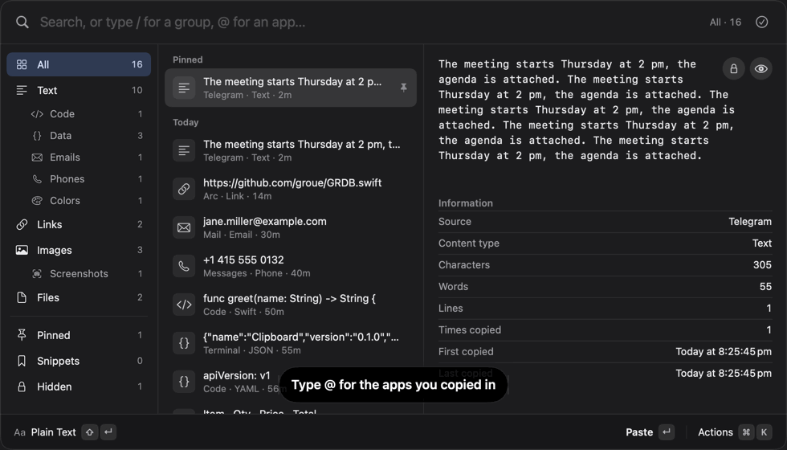
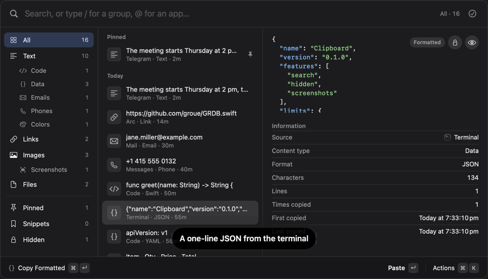
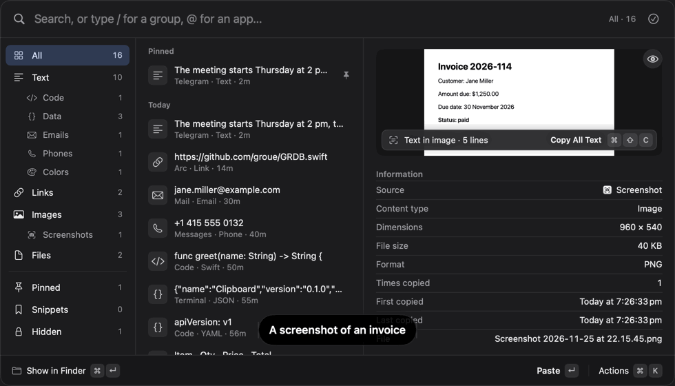
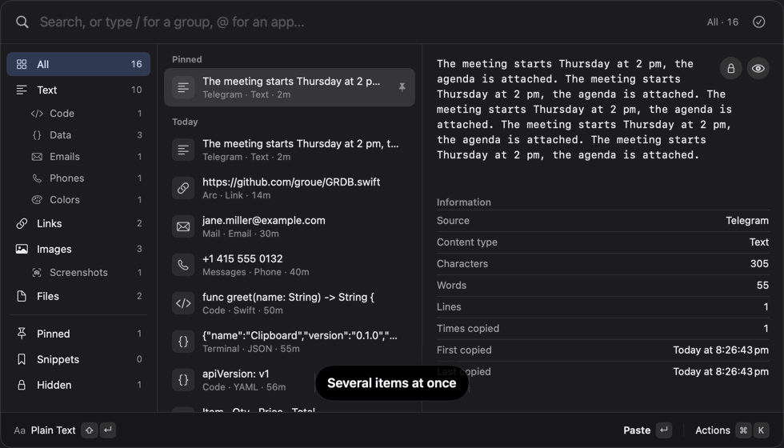

# Trove

**An encrypted clipboard history for macOS.** Trove keeps what you copy — text, links, images, files, colors, code — so you can find it again in a second. Open it with **⌥ Space**, type, press **↵**, and it pastes into the app you were in.

Everything stays on your Mac, encrypted. Trove itself has no network access.

> Status: pre-release (0.1.0), in active development. macOS 14 or later.


---

## Contents

- [The basics](#the-basics)
- [Finding things](#finding-things): search, groups with `/`, apps with `@`
- [Doing things](#doing-things): actions (⌘K), editing and transforms (⌘E), snippets (⌘S)
- [Images and screenshots](#images-and-screenshots): text in images, screenshots, image files
- [Several items at once](#several-items-at-once): select, paste, drag
- [Hidden items and sensitive content](#hidden-items-and-sensitive-content)
- [Privacy and security](#privacy-and-security): what is stored, how it is encrypted
- [Import and export](#import-and-export): Raycast, Maccy, Alfred
- [Settings](#settings)
- [All keyboard shortcuts](#all-keyboard-shortcuts)
- [Building from source](#building-from-source)
- [Project layout](#project-layout)
- [Acknowledgements](#acknowledgements)

---

## The basics

1. **Open** — press **⌥ Space** in any app. The panel opens over it; the app you were in keeps its place.
2. **Find** — type to search. **↑ ↓** move through the items, **← →** move between the groups on the left and the items.
3. **Use** — **↵** pastes the item into that app (or only copies it, if you prefer: *Settings › General › Return Key*). **⇧↵** pastes it as plain text.
4. **Close** — **Esc** clears the search; a second Esc closes the panel.

The panel has three parts:

| Left | Middle | Right |
| --- | --- | --- |
| **Groups**: All, Text (with Code, Data, Emails, Phones, Colors), Links, Images (with Screenshots), Files, Pinned, Snippets, Hidden | The **items**, newest first, by day | A **preview** and the item's **details** (source app, size, dates, how often you copied it) |

The bottom bar always shows the same two buttons on the right — **Paste ↵** and **Actions ⌘K** — and, on the left, the one action that fits the selected item: *Open in Browser* for a link, *Show in Finder* for a file or screenshot, *Compose Email*, *Call*, *Copy Formatted* for JSON, *Save Image…* for a copied image (all on **⌘↵**).

The panel opens in the group you used last. Change it in *Settings › General › Panel Opens In*.

## Finding things

### Search

Type anything. Trove searches the text of every item, the names of files and screenshots, the apps you copied in, and — see below — **the text inside images**. Search is instant even with tens of thousands of items, and ignores case, accents and Turkish letters (`yılmaz` finds `Yilmaz`).

### Jump to a group with `/`


Type **/** and the start of a group's name: `/im` → Images, `/co` → Code and Colors. A short list opens; **↵** or **⇥** chooses, **↑ ↓** move in it.

- The group stays as a **chip** at the start of the search field. Keep typing to search inside it.
- `/im invoice` — a space chooses the first match and keeps the rest as your search.
- **⌫** in an empty search removes the chip (back to All).
- Group names work in English and Turkish, and with a few aliases: `/img`, `/photo`, `/json`, `/password`.
- Text that matches no group (`/usr/bin`) is an ordinary search, so paths still work.

### Only one app with `@`



Type **@** to see the apps you copied things in, with their icons and counts, most used first. `@ar` → Arc. The app becomes a chip next to the group chip, so you can combine them: **[Images] [Arc] invoice**. Chips stay in the order you add them; ⌫ in an empty search removes the app chip first, then the group.

## Doing things

### Every action with ⌘K


**⌘K** opens a menu of everything you can do with the selected item, each with its shortcut: paste, paste as plain text, open, show in Finder, copy the text in an image, edit, pin, move to Hidden, save as a snippet, select several, open in the terminal, delete, settings, *How Trove Works*. Type to filter it, **↑ ↓** and **↵** to run one.

You never *need* the menu: every action also has its own shortcut, which works with the menu open or closed.

### Edit and transform with ⌘E



**⌘E** turns the preview into an editor for the selected item (or for the text found in an image). Change the text by hand, or use the five small menus above it — each change applies to the whole text:

| Menu | Transforms |
| --- | --- |
| **Case** | UPPERCASE, lowercase, Title Case, Sentence case (following the app's language: Turkish `i` → `İ`) |
| **Clean Up** | Trim spaces at line ends, collapse repeated spaces, remove empty lines |
| **Lines** | Sort A–Z, remove duplicate lines, reverse the order |
| **Encode** | URL encode / decode, Base64 encode / decode |
| **JSON** | Format, minify |

All of them are also in **⌘K** while editing. A transform that does not apply (Base64 that isn't Base64) leaves the text as it is and says why. **⌘↵** pastes the result and keeps it in your history as a new item; **Esc** cancels; *Undo All Changes* goes back to the original.

### Keep snippets with ⌘S


**⌘S** keeps a text item as a **named snippet** — an address, an IBAN, a signature, a command you type often. Snippets live in their own group and:

- are **never removed** by the history limits or by *Clear History*;
- are found by their **name** and their content;
- stay as they are when you copy the same text again (that becomes a separate history item).

**⌘R** renames a snippet, **⌘E** edits its text (**⌘S** saves), *⌘K › New Snippet…* starts an empty one, *⌘K › Remove from Snippets* makes it an ordinary item again.

## Images and screenshots

### Search the text in screenshots



Trove reads the text in images — screenshots, images you copy, image files you copy in Finder — with Apple's Vision framework, **on this Mac**. Then:

- **Search finds an image by a word in it.** Under the item, the matching text shows; in the preview, the word is **boxed in yellow**.
- A bar under the image says what **⌘⇧C** copies: **the matching line** while you search, or **all the text** otherwise.
- The **eye button** opens a large preview with the image and, next to it, all its text — select any part and copy it.

New images are read right after they are saved; older ones in the background, newest first. The text is stored encrypted with the rest of your history. Turn it off in *Settings › Privacy › Text in Images*.

> Vision does not support Turkish on current macOS, so `ş`, `ı`, `ğ` are read as plain letters. Search ignores the difference, so a search with or without Turkish letters finds the image either way.

### Screenshots

macOS saves screenshots as files, so they never reach the clipboard. Trove can watch your screenshot folder (it asks once, and suggests the folder macOS uses) and adds each new screenshot to **Images › Screenshots**, with its file: **⌘↵** shows it in Finder, and dragging it out uses the original file.

### Image files

An image copied in Finder is a file — Trove keeps it in **Files** and also in **Images**, with a preview, so you see the picture rather than its path.

## Several items at once



- **⌘-click** picks items one by one, **⇧-click** or **⇧↑ ↓** picks a range, **⌘⇧S** (or the ✓ button in the search bar) turns select mode on, **⌘A** picks everything in select mode, **Esc** ends it.
- **↵** pastes all the picked items (text items as one text, one per line; images and files as files).
- **⌘D** deletes them, after asking.
- **Drag** any item — or all the picked ones — into another app or a Finder folder. Images go as files (a screenshot as its own file).

## Hidden items and sensitive content

Some things you copy should not sit in a searchable history. Trove recognises **API keys and tokens** (Anthropic, OpenAI, GitHub, AWS, Slack, Google, Stripe), **JSON Web Tokens**, **private keys**, **payment card numbers** and **IBANs**, and by default puts them in the **Hidden** group instead (*Settings › Privacy › Sensitive Content*: keep in Hidden, keep for a minute, or don't save).

- Hidden items are **sealed with this Mac's Secure Enclave** and open only after **Touch ID** (or your password).
- They never appear in other groups or in search — only by the name you give them (**⌘R**).
- **⌘⇧H** moves any text item into Hidden by hand (and back, once revealed).
- Content that password managers mark as concealed is **never saved** at all, and apps you list in *Ignored Apps* are not recorded.

You can also lock the whole panel with Touch ID after some minutes of not using it (*Settings › Security*), and **pause recording** from the menu bar, Settings, or a global shortcut you choose.

## Privacy and security

**Your history never leaves your Mac.** Trove itself has **no network entitlement** — the macOS sandbox does not let it open a connection. The only part that may connect is Sparkle's separate, sandboxed *download service*, which reads the list of releases when it checks for updates; it never sees your history.

**What is stored, and how**

| What | Where | Protection |
| --- | --- | --- |
| The history database | A *Clipboard History* folder in a location you choose (a synced folder is fine) | **SQLCipher**, AES-256: the whole database and its search index |
| Images | Same folder | **AES-256-GCM**, one file per image |
| The data key | Your login Keychain (not synced) | A random 256-bit key; separate database and image keys are derived from it with HKDF |
| Key file (`clipboard.key`) | Same folder | With a **recovery password**, the data key is wrapped with PBKDF2-SHA256 (600,000 rounds) — so the history opens on another Mac |
| Hidden items | In the database | Sealed to a **Secure Enclave** P-256 key (ECDH + HKDF + AES-GCM); opened with Touch ID |
| Text read in images | In the database | Encrypted with it |
| Settings | macOS preferences | No clipboard content |

Other details:

- The app is **sandboxed**, **hardened**, signed with a Developer ID and **notarized** by Apple.
- **Exports** default to an encrypted `.clipboardexport` (PBKDF2-SHA256, 600,000 rounds → AES-256-GCM). Hidden items are never exported.
- Dragging or group-copying a clipboard image writes a temporary PNG, readable only by you, removed after an hour, at launch and at quit.
- Nothing is deleted or converted without asking: limit changes, *Clear History* and every delete show what they will remove first.

## Import and export

*Settings › Storage › Import…* opens a window that walks you through it: choose the source (the apps on your Mac come first, with their own icons), enter a password if the file has one, look at the **summary** — how many texts, links and files, the date range, what is already in Trove, what goes to Hidden — and confirm. Nothing is saved before that. If your history limits would remove the older imported items, the summary says how many and offers to lift those limits.

| Source | How |
| --- | --- |
| **Raycast** | In Raycast: *Settings › Advanced › Export*, with Clipboard History. Choose the `.rayconfig` file and enter its password. Text, links, rich text, files, dates, counts and source apps are imported; Raycast keeps images outside its export. |
| **Maccy** | Choose Maccy's folder (the file window opens there). Read from a private copy, including rows still in its write-ahead log. |
| **Alfred** | Choose Alfred's *Databases* folder (`clipboard.alfdb`). |
| **Trove** | An export from this or another Mac: `.clipboardexport` (with its password) or `.json`. Snippet names come along. |

Items you already have are **merged**, not duplicated. **Export** (*Settings › Storage › Export…*): encrypted file, JSON or CSV; everything, a period, or pinned items and snippets only; with or without images.

## Settings

| Tab | What is there |
| --- | --- |
| **General** | Open at login · the panel shortcut · pause recording, and a pause shortcut · which group the panel opens in · what ↵ does (paste or copy) · terminal for ⌘T · language · menu bar and Dock icons · screenshot folder · sidebar groups · appearance (dark, light, system) · version, *How Trove Works*, acknowledgements · updates |
| **Storage** | Where the history is · keep history for (7–90 days or forever) · maximum items · maximum size · skip large images · usage · clear the last hour, day or everything · import and export |
| **Security** | Panel lock with Touch ID · recovery password |
| **Privacy** | Sensitive content · text in images · page addresses from Chromium browsers · ignored apps |
| **Shortcuts** | Every shortcut, by section |

## All keyboard shortcuts

**Anywhere**

| Keys | Does |
| --- | --- |
| ⌥ Space | Open or close Trove (change it in Settings) |
| *(your choice)* | Pause or resume recording (Settings › General › Pause Shortcut) |
| ⌥ Space, then ⌥P | Pause or resume recording from the panel (keep ⌥ held) |

**In the panel**

| Keys | Does |
| --- | --- |
| ↵ / ⇧↵ | Paste (or copy) / as plain text |
| ⌘↵ | The item's own action: open link, show in Finder, compose email, call, copy formatted, save image |
| ↑ ↓ / ← → | Move through items / between groups and items |
| ⌘1 … ⌘5 | All, Text, Links, Images, Files |
| / · @ | Jump to a group · only one app |
| ⌘K | All actions |
| ⌘E | Edit and transform |
| ⌘S | Save as a snippet (in the editor: save the snippet) |
| ⌘R | Name a hidden item / rename a snippet |
| ⌘⇧H | Move to Hidden, or back |
| ⌘⇧C | Copy the text in an image (the matching line while searching) |
| ⌘T | Open a file's folder in your terminal |
| ⌘P | Pin or unpin |
| ⌥P | Pause or resume recording, and close |
| ⌘D | Delete (asks first) |
| ⌘⇧S · ⌘-click · ⇧-click · ⇧↑↓ · ⌘A | Select several |
| ⌘, | Settings |
| Esc | Clear the search, end select mode, close |

## Building from source

Requirements: macOS 14+, the Xcode Command Line Tools (Swift 6.1). No Xcode project — SwiftPM and a Makefile.

```sh
make app       # build, assemble and sign build/Trove.app
make run       # build and open it
make test      # unit tests (release, with timing checks)
make layout    # render the UI offscreen (English and Turkish) and run layout checks
make demos     # render the animations used here and in the app
make release   # sign with a timestamp, notarize, staple, and make build/Trove.dmg
```

`SIGN_ID` (default: *Developer ID Application*) and `NOTARY_PROFILE` (a `notarytool` keychain profile) can be set on the command line. SQLCipher comes as Zetetic's signed binary framework (its Team ID is checked); GRDB is vendored with its SQLCipher changes in `Vendor/GRDB`; Sparkle comes as its binary framework.

The layout checks matter: they render every kind of item in both languages and fail if anything in the panel moves sideways, if the sidebar does not fit, or if a button changes place between items.

## Project layout

```
Sources/Trove/
  App/          app lifecycle, settings, import flow, text indexer, updates
  Capture/      pasteboard monitor, classifier, content detection, Vision OCR, copy and paste
  Panel/        the panel: model, views, actions menu, editor, transforms, drag and drop
  Settings/     settings window and the import window
  Onboarding/   first-run setup and "How Trove Works"
  Security/     data key, vault, keychain, Secure Enclave, sensitive-content detector
  Storage/      encrypted store (GRDB + SQLCipher), migrations, import/export, Raycast reader
  Debug/        offscreen snapshots, layout checks and demo rendering (not in the shipped app)
Tests/TroveTests/   unit tests
Resources/          Info.plist, entitlements, icon, translations, demos, licences
Vendor/GRDB/        GRDB 7 with SQLCipher support
```

## Acknowledgements

Trove is built with [GRDB](https://github.com/groue/GRDB.swift) (MIT), [SQLCipher](https://www.zetetic.net/sqlcipher/) Community Edition (BSD-style) and [Sparkle](https://sparkle-project.org) (MIT). Their licences are in *Settings › General › Acknowledgements* and in `Resources/Licenses`.

Trove is not affiliated with Raycast, Maccy or Alfred; their names appear only to describe what can be imported.
